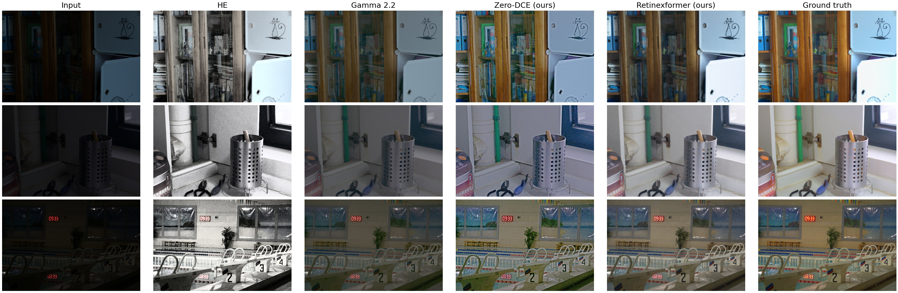
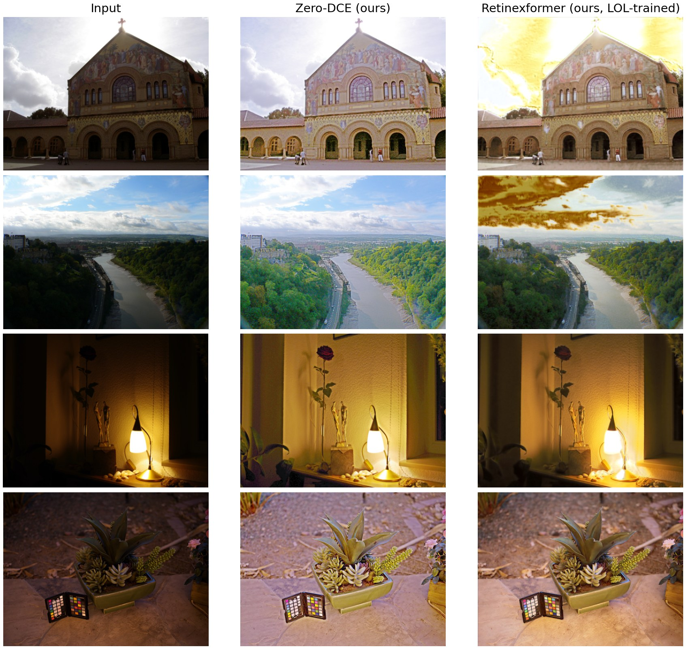

# Low-Light Image Enhancement: Reproducing Zero-DCE and Retinexformer

MM803 group project, University of Alberta (part 1: images; video comes in part 2).

We retrain two published methods from their official code on one RTX 4080 SUPER (16 GB) and compare them with classical baselines on LOL-v1 and on real photos without ground truth.

- **Zero-DCE** (Guo et al., CVPR 2020): zero-reference curve estimation, 79K parameters.
- **Retinexformer** (Cai et al., ICCV 2023): supervised one-stage Retinex transformer, 1.6M parameters.

## Results on LOL-v1 (15 test pairs, last checkpoint, no GT-mean correction)

| Method | PSNR (dB) | SSIM | LPIPS | Params | GPU time / image |
|---|---|---|---|---|---|
| Input | 7.77 | 0.191 | 0.560 | – | – |
| Gamma (2.2) | 13.28 | 0.592 | 0.344 | – | CPU |
| HE | 14.24 | 0.425 | 0.592 | – | CPU |
| CLAHE | 9.13 | 0.357 | 0.503 | – | CPU |
| Zero-DCE, official weights | 14.86 | 0.562 | 0.335 | 0.079M | ≈ 3 ms |
| **Zero-DCE, ours** | **17.02** | 0.559 | 0.358 | 0.079M | ≈ 3 ms |
| Retinexformer, official weights | 25.17 | 0.844 | 0.131 | 1.606M | ≈ 44 ms |
| **Retinexformer, ours** | **23.27** | **0.827** | **0.146** | 1.606M | ≈ 44 ms |

- Before training, we checked our evaluation code: with the official weights it gives the published numbers. Zero-DCE scores 14.86 dB, which matches Table 1 of the Retinexformer paper. Retinexformer scores 25.17 dB against 25.16 in its paper.
- Our Retinexformer peaked at 23.91 dB on the test set at 130k iterations. Neighbouring checkpoints differ by up to 1.7 dB, so a single training run is noisy.
- Zero-DCE loss ablation (PSNR / SSIM):

  | Variant | PSNR (dB) / SSIM |
  |---|---|
  | w/o L_spa | 16.92 / 0.556 |
  | w/o L_exp | 7.74 / 0.190 |
  | w/o L_col | 5.97 / 0.288 |
  | w/o L_tvA | 12.06 / 0.405 |

- On real photos (DICM, LIME, MEF, NPE, VV), the LOL-trained Retinexformer corrupts bright skies and lamps. Zero-DCE does not have this problem.




Full metrics: [`results/lol_v1_metrics.json`](results/lol_v1_metrics.json). Training logs: [`logs/`](logs/).

## Repository layout

```
setup.sh                 clone upstream repos at pinned commits, apply fixes, download data + official weights
patches/zero-dce.patch   Pillow ANTIALIAS -> LANCZOS, clip_grad_norm_ , no hard-coded GPU
configs/                 Retinexformer config (official LOL-v1 config, renamed, val/save every 5k, wandb off)
scripts/eval_lol.py      evaluates all methods on LOL-v1 (+ --unpaired for the real-world sets)
scripts/make_figs.py     figures in figs/
scripts/zerodce_train_ablation.py   lowlight_train.py with --w_spa/--w_exp/--w_col/--w_tv flags
scripts/resize_256.py    pre-resize SICE images for faster ablation runs
```

Datasets and model weights are not included. `setup.sh` downloads them.

## Reproduce

```bash
conda create -n llie python=3.10 -y && conda activate llie
pip install torch==2.4.1 torchvision==0.19.1 --index-url https://download.pytorch.org/whl/cu121
pip install -r requirements.txt
./setup.sh

# Zero-DCE (~1 h)
cd Zero-DCE/Zero-DCE_code
python lowlight_train.py --lowlight_images_path ../../data/zerodce_train/train_data/ \
    --num_epochs 200 --snapshots_folder snapshots_repro/
# ablation, e.g. without the colour loss
python ../../scripts/resize_256.py ../../data/zerodce_train/train_data ../../data/zerodce_train/train_256
python lowlight_train_ablation.py --lowlight_images_path ../../data/zerodce_train/train_256/ \
    --num_epochs 200 --w_col 0 --snapshots_folder snapshots_abl_no_col/
cd ../..

# Retinexformer (~3 h). Its setup.py fails with recent pip, so run from source.
cd Retinexformer
PYTHONPATH=. python basicsr/train.py --opt Options/Repro_RetinexFormer_LOL_v1.yml
cd ..

# Evaluation + figures
python scripts/eval_lol.py --unpaired --extra \
  ZDCE_no_col=zdce:Zero-DCE/Zero-DCE_code/snapshots_abl_no_col/Epoch199.pth
python scripts/make_figs.py
```

## References

- C. Guo et al. Zero-Reference Deep Curve Estimation for Low-Light Image Enhancement. CVPR 2020. https://github.com/Li-Chongyi/Zero-DCE
- Y. Cai et al. Retinexformer: One-stage Retinex-based Transformer for Low-light Image Enhancement. ICCV 2023. https://github.com/caiyuanhao1998/Retinexformer
- C. Wei et al. Deep Retinex Decomposition for Low-Light Enhancement (LOL). BMVC 2018.
